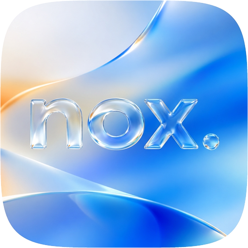

<p align="center">
  
</p>

<h1 align="center">NOX</h1>

> [!IMPORTANT]
> **Disclaimer.** NOX is an independent, fan‑made project. It is **not affiliated with, endorsed by, or sponsored by
> Apple Inc.** in any way. NOX uses its own names (Deck, Notch, Rail, Scene, Quick Search, Quick Panel, Crystal, and so on).
> “Apple”, “macOS”, “Tahoe”, “Liquid Glass”, “Dynamic Island”, “Stage Manager”, “Mission Control”, “Spotlight”,
> “Launchpad”, “AirDrop”, “AirPlay” and related names are trademarks of Apple Inc. NOX ships no Apple code, icons,
> fonts, or other assets.

<p align="center">
  <b>A modern glass desktop shell for Windows 11.</b><br>
  Deck · Notch · Rail · Quick Panel · Quick Search · Scene · Widgets — native, written in Rust, ~15 MB of RAM.<br>
  <sub>Built by <a href="https://opankcs.com">opankcs.com</a></sub>
</p>

<p align="center">
  <a href="https://github.com/NauvalXQF/Nox-UI/releases/latest"></a>
  <a href="https://github.com/NauvalXQF/Nox-UI/releases"></a>
  
  
  
  
</p>

<p align="center">
  <a href="#-install">Install</a> ·
  <a href="#-how-to-use-each-feature">How to use</a> ·
  <a href="#-modular-turn-off-what-you-dont-want">Modular</a> ·
  <a href="#-privacy">Privacy</a> ·
  <a href="#-built-with">Built with</a> ·
  <a href="#-build-from-source">Build</a> ·
  <a href="#-license">License</a>
</p>

---

## ✨ What is NOX?

NOX turns Windows 11 into a clean, fluid glass desktop shell:

- a magnifying **Deck** for your apps,
- an interactive **Notch** at the top of the screen for music with live lyrics, instant native notifications, Pomodoro timer, Google Tasks & Calendar, Ask Gemini AI, downloads, and file drops,
- a **Rail** with real app menus, Wi‑Fi, and battery,
- a **Quick Panel** for toggles and sliders, **Quick Search**, **Scene**, **Overview**, and desktop **Widgets**,

all drawn with frosted glass materials and springy GPU‑composited animations.

It is a single lightweight native program: no Electron, no WebView, no background telemetry services, no account required. At idle it uses roughly **15 MB** of private memory.

<p align="center">
  
</p>

### 🆕 What’s New in NOX v0.4.1

- **NOX Rebrand & Liquid Glass Identity**: new `nox.` icon, renamed binaries (`nox.exe`, `nox-guard.exe`), config stored in `%APPDATA%\NOX`, and automatic seamless migration from legacy `%APPDATA%\ABRA` settings and credentials.
- **Instant Native Notifications & Deep‑Link Activation**: reads Windows 11 notifications natively via WinRT `UserNotificationListener` (with automatic UI Automation Zero‑Config fallback), and activates notifications directly via Windows Toast COM (`INotificationActivationCallback`) to jump straight into the exact WhatsApp, Telegram, or Discord chat room instantaneously.
- **Refined Notch & 4 Visibility Modes**: choose **Notch** (attached to top edge) or **Capsule** (floating) with **Fixed**, **Overlay**, **Smart** (auto‑hides when any window is maximized or overlaps the Notch), and **Auto‑hide** modes, pure OLED `#000000` edges, and dual‑layer GPU shadow.
- **Live Lyrics & Adaptive Now Playing**: adaptive album‑art color tint, staggered 4‑layer Apple Music–style lyrics transitions, and [LRCLIB](https://lrclib.net) + local `.lrc` support.
- **Productivity & Integrations**: Pomodoro timer with an adaptive Detached Timer Pill, **Google Tasks & Calendar** sync, **Ask Gemini AI** with live model selection, and a dedicated **Integrations** tab in Settings.
- **120fps Smooth Settings**: GPU‑smooth inertial scrolling with a draggable animated scrollbar across all 9 Settings tabs (English & Indonesian).
- **1‑Click Native Setup**: extract the release ZIP and double‑click `Install-NOX.cmd` to install into `%LOCALAPPDATA%\NOX`, register the Windows Sparse Package Identity (`Opankcs.NoxShell`), and launch NOX automatically.

<details>
<summary><b>Earlier milestones (0.4.0 & 0.3.0)</b></summary>

- **Desktop widgets**: Clock, World Clock, Today, Month, Digital Clock, Battery, and System Monitor in **Original** or **Crystal** material with snap‑to‑grid placement.
- **Global scale** (100 · 125 · 150%) for Deck, Notch, Rail, and Quick Panel.
- **Quick Panel editing**: drag controls to rearrange and resize them from a glass corner handle.
- **Wi‑Fi & Bluetooth**: connect to saved networks without location access, live signal strength, and one‑click Bluetooth audio connect.
- **Send to phone**: drop files onto the Notch and scan a QR code from Android or iPhone over local Wi‑Fi.
- **Window animations & Scene**: smooth open/close animations and live tilted Scene cards.
</details>

---

## 🧩 Modular: turn off what you don’t want

Every part of NOX is independent. Keep only the pieces you like:

| Part | Where to turn it off |
|---|---|
| Deck | *Settings → Deck → Enable Deck* |
| Notch | *Settings → Notch → Enable Notch* |
| Rail | *Settings → Rail → Enable Rail* |
| Widgets | Right‑click a widget → *Remove Widget* |
| Scene | *Settings → Scene*, or the Quick Panel control |
| Screen Corners | *Settings → Screen Corners* (set each corner to “None”) |
| Windows taskbar | *Settings → General → Hide the Windows taskbar* (turn off to keep your taskbar) |
| Window animations | *Settings → General → Window animations* |
| Recent apps in the Deck | *Settings → Deck → Recent apps* |

Use only the Notch with your normal taskbar, only the Deck, only the Rail — any combination works.

---

## 🚀 Install

> Requires **Windows 11** (build 22000 or newer), 64‑bit.

Download **`NOX-v0.4.1-win64.zip`** from the **[Releases](https://github.com/NauvalXQF/Nox-UI/releases/latest)** page.

| Mode | How to run | Best for |
|---|---|---|
| **1‑Click Native Setup** *(Recommended)* | Extract the ZIP → double‑click **`Install-NOX.cmd`** | Most people. Installs to `%LOCALAPPDATA%\NOX`, registers Windows Sparse Package Identity (`Opankcs.NoxShell`) for **Native WinRT notifications & instant deep‑link activation**, and launches NOX automatically. |
| **Portable / Zero‑Config** | Extract the ZIP → double‑click **`nox.exe`** | Trying NOX without installation. Keep `nox.exe` and `nox-guard.exe` in the same folder. Notifications still work automatically via UI Automation (Zero‑Config). |

### Step‑by‑step (Recommended)

1. Download **`NOX-v0.4.1-win64.zip`** from [Releases](https://github.com/NauvalXQF/Nox-UI/releases/latest).
2. Extract the entire ZIP to any folder (do not run directly from inside the ZIP preview).
3. Double‑click **`Install-NOX.cmd`**.
   - If Windows SmartScreen warns about an unsigned app, click **More info → Run anyway** (only for official releases from this repository).
4. Follow the brief prompt — NOX installs to `%LOCALAPPDATA%\NOX` and starts automatically.
5. When Windows asks for notification access, click **Allow** so the Notch can display live notifications and open chats instantaneously.

### First run

- The Windows taskbar hides and the Rail, Notch, and Deck appear (turn off taskbar hiding anytime in *Settings → General*).
- Open **Settings**: right‑click the Deck → **NOX Settings…**, or click the logo in the Rail.
- Language: *Settings → General → Language* (**English** or **Indonesia**).
- Optional integrations (Google Tasks/Calendar & Ask Gemini AI): configure in *Settings → Integrations*.

### Updating & Migration

- Extract the new ZIP and run `Install-NOX.cmd` again — your existing settings, pinned apps, Quick Panel layout, and credentials are preserved.
- Existing configurations from `%APPDATA%\ABRA` are automatically migrated to `%APPDATA%\NOX` on first launch.

### Quit and Uninstall

- **Quit**: right‑click an empty area of the Deck (or the Start icon) → **Quit NOX**. The Windows taskbar returns automatically. If NOX is ever force‑closed, `nox-guard.exe` restores the taskbar and any parked windows.
- **Uninstall**: double‑click **`Uninstall-NOX.cmd`** (in the extracted folder or `%LOCALAPPDATA%\NOX\Uninstall-NOX.cmd`). To remove settings as well, delete `%APPDATA%\NOX`.

---

## 📖 How to use each feature

<details open>
<summary><b>🕳 Notch</b></summary>

The interactive glass island at the top center of your screen. Choose **Notch** (attached to the top edge) or **Capsule** (floating) and visibility behavior (**Fixed · Overlay · Smart · Auto‑hide**) in *Settings → Notch*.

<p align="center">
  
</p>

- **Hover** to peek, **rest the cursor ~0.3 s** (or click) to expand the panel. Scroll the mouse wheel to switch tabs.
- **When idle**: greeting with time, date, and battery; **music & lyrics** while a song is loaded; or a compact pill.

<p align="center">
  
  
</p>

- **Play & Live Lyrics**: song card (adaptive album‑art tint, title, seekable progress, controls) and staggered synced lyrics. Put custom `Artist - Title.lrc` files in `%APPDATA%\NOX\lyrics`, or let NOX fetch them from [LRCLIB](https://lrclib.net).

<p align="center">
  
</p>

- **Notifications & Instant Deep‑Link**: incoming Windows 11 notifications pop seamlessly into the Notch; clicking a notification (WhatsApp, Telegram, Discord, etc.) activates its native Windows Toast COM callback to jump straight into the exact conversation without delay.
- **Downloads**: Microsoft Store, Steam, and browser downloads with a live progress ring.
- **Shelf & Send to Phone (Android & iPhone, no app)**: drag files onto the Notch and drop them on **Keep on Shelf** · **Send** · **Copy to…** · **Open with…**. Scan the QR code from your phone on the **same Wi‑Fi** to download immediately.

<p align="center">
  
  
</p>

- **Timer, Tasks & Calendar**: Pomodoro timer with a floating Detached Timer Pill when minimized, plus upcoming events and **Google Tasks & Calendar** sync.
- **Ask Gemini AI**: ask quick questions directly from the Notch using your own Gemini API key (*Settings → Integrations*).
</details>

<details open>
<summary><b>🎛 Deck</b></summary>

- **Open / switch apps**: click an icon. Running apps show a dot. Hover to magnify; hover a running app for live window previews.
- **Keep / remove**: right‑click an app → *Keep in Deck* / *Remove from Deck*. Drag icons to reorder.
- **Recent apps**: recently closed apps appear on the right; right‑click → *Remove from Deck*, or toggle in *Settings → Deck*.
- **Close an app**: right‑click it → **Close**. **Quit NOX** appears when you right‑click an empty area or the Start icon.
- **Minimize** a window and it flies into the Deck with a **Funnel** or **Scale** effect.
- **App Grid**, **Downloads** stack, glass **Trash** (right‑click → *Empty Trash*), and custom icons (right‑click → *Change icon…*).
- **Size, magnification, behaviour (Fixed · Overlay · Smart)**: *Settings → Deck*.
</details>

<details open>
<summary><b>📋 Rail</b></summary>

- **Logo menu**: About this PC, System Settings, Microsoft Store, NOX Settings, App Grid, Overview, Force Quit, Sleep, Restart, Shut Down, Lock Screen. Use your own image as the logo in *Settings → Rail → Rail logo*.
- **App name and menus**: the active app’s native classic menus (File, Edit, etc.).
- **Right side**: battery (percentage inside, outside, or hidden), **Wi‑Fi** with live signal strength, Quick Search, Quick Panel, and clock.
- **Background**: transparent (with a soft shade), light, dark, or glass material.
- **Wi‑Fi menu**: toggle, saved networks (click to connect), and live signal strength. Windows only exposes *nearby* networks when **Location** is enabled; NOX never reads or stores your location.
</details>

<details open>
<summary><b>🎚 Quick Panel</b></summary>

- Click the two‑switch icon in the Rail.
- **Wi‑Fi / Bluetooth**: click the round icon to toggle; click the card to open the network / device picker. Bluetooth **headphones and speakers connect in one click**.
- **Display / Sound sliders**, **sound output** switcher, Playing, Dark Mode, Scene, Overview, Screenshot, and more.

<p align="center">
  
</p>

- **Edit Controls…**: remove with **−**, drag to rearrange, drag the glass corner handle to resize horizontally/vertically/diagonally, or add controls from the searchable gallery.

<p align="center">
  
</p>
</details>

<details open>
<summary><b>🧱 Widgets</b></summary>

- Open the gallery from *Settings → Widgets → Add widgets*, or right‑click a widget → *Edit Widgets…*.
- **Click** or **drag** widgets onto the desktop with snap‑to‑grid placement.
- Material: **Original** (solid light/dark cards) or **Crystal** (frosted glass) in *Settings → Widgets*.

<p align="center">
  
  
</p>
</details>

<details open>
<summary><b>🔍 Quick Search</b></summary>

- Press `Ctrl` + `Space` to search **Apps**, **Files**, **Actions**, and **Clipboard** (switch tabs with `Ctrl` + `1`…`4`).
- Built‑in calculator, recent files with thumbnails, file‑type filters, custom quick actions, and optional in‑memory clipboard history.

<p align="center">
  
</p>
</details>

<details open>
<summary><b>🎬 Scene · 🪟 Overview · App Grid · Screen Corners · HUD</b></summary>

- **Scene**: other windows become live, tilted cards in a side strip; click one to fly it back, Shift‑click to group, click wallpaper to clear stage, and `Alt` + `Tab` uses NOX’s switcher while Scene is active.
- **Overview** (`Ctrl` + `↑`): all windows and virtual desktops at a glance.
- **App Grid** (`Ctrl` + `Shift` + `Space` or Deck button): full‑screen grid of installed apps.
- **Screen Corners**: move the pointer to a screen corner to trigger an action.
- **Volume & brightness HUD**: glass card showing your active output device.

<p align="center">
  
</p>
</details>

<details open>
<summary><b>🎨 Appearance & ⚙️ Settings</b></summary>

- *Settings → Appearance*: Auto · Light · Dark, accent color, icon style (Default · Dark · Clear · Tinted), glass material (**Blur**, **Crystal**, or **Black**), separate Notch material, blur, transparency, **global scale**, and optional icon packs (`%APPDATA%\NOX\iconpack`).
- *Settings → Integrations*: configure **Google Tasks & Calendar** OAuth and **Ask Gemini AI** (with live model selector).
- 9 tabs in a floating glass sidebar with search, back/forward navigation, 120fps smooth scrolling with draggable scrollbar, and **English / Indonesian** UI.
- **Quick shortcuts**: `` Alt+` `` cycles windows of the same app, `Ctrl+Alt+H` hides, `Ctrl+Alt+M` minimizes, `Ctrl+Alt+Q` quits the active app (*Settings → General*).

<p align="center">
  
</p>
</details>

### Keyboard shortcuts

| Shortcut | Action |
|---|---|
| `Ctrl` + `Space` | Quick Search |
| `Ctrl` + `Shift` + `Space` | App Grid |
| `Ctrl` + `1` … `4` | Inside Quick Search: Apps · Files · Actions · Clipboard |
| `Ctrl` + `↑` | Overview |
| `Alt` + `Tab` | NOX window switcher (while Scene is on) |
| `Esc` | Close the active overlay |

Indonesian guide: [`docs/PANDUAN.md`](docs/PANDUAN.md).

---

## 🔒 Privacy

**NOX does not collect telemetry, analytics, or ads.** All settings live locally in `%APPDATA%\NOX`, and optional OAuth tokens / API keys are stored securely in **Windows Credential Manager** (`NOX/...`).

- **Lyrics**: if a song has no local `.lrc` file, NOX queries [LRCLIB](https://lrclib.net) using only title, artist, album, and duration. You can disable online lyrics in *Settings → Notch*.
- **Google Tasks/Calendar & Ask Gemini AI** *(opt‑in)*: completely inactive until you enter your own Google OAuth credentials or Gemini API key in *Settings → Integrations*. Requests go directly from your PC to Google APIs with no intermediary server.
- **Notifications**: read locally via Windows `UserNotificationListener` / UI Automation and local read‑only `wpndatabase.db` lookup for instant deep‑link activation. Notification contents never leave your device.
- **Send to phone**: spawns a temporary HTTP server on your **local Wi‑Fi network only** under a random URL, serving only dropped files, and shuts down automatically when done, after 15 idle minutes, or when NOX quits.
- **Clipboard history**: optional, text only, kept in RAM for 8 hours, never written to disk.
- **Keyboard hook**: active only to intercept `Alt+Tab` while Scene is enabled; keystrokes are never logged or sent.

---

## 🛠 Built with

- **[Rust](https://www.rust-lang.org)** — entire workspace across five crates.
- **[windows‑rs](https://github.com/microsoft/windows-rs)** — direct Win32 and WinRT bindings.
- **Windows.UI.Composition & D3D11** — GPU‑composited visuals, spring animations, dual‑layer shadows, and glass materials on a shared graphics device.
- **Win32 / WinRT Platform APIs** — WASAPI, System Media Transport Controls, `UserNotificationListener`, Windows Toast COM (`INotificationActivationCallback`), WLAN, Bluetooth, WIC, DirectWrite / GDI text rendering, OLE drag‑and‑drop.
- **Bundled font**: **[Inter](https://rsms.me/inter/)** (SIL Open Font License 1.1), with Segoe UI Variable fallback.

No Electron, no WebView, no .NET runtime.

---

## 🛠 Build from source

<details>
<summary><b>Step by step</b></summary>

### 1. Install the toolchain

1. Install **Rust** via [rustup](https://rustup.rs) with the MSVC target:
   ```powershell
   rustup default stable-x86_64-pc-windows-msvc
   ```
2. Install **Visual Studio Build Tools** with the **Desktop development with C++** workload (includes `link.exe` and Windows 11 SDK).
3. Install **Git**.

### 2. Clone and build

```powershell
git clone https://github.com/NauvalXQF/Nox-UI.git
cd Nox-UI
cargo build --release --workspace
.\target\release\nox.exe
```

This produces `nox.exe` and `nox-guard.exe` in `target\release\`.

### 3. Tests and release package

```powershell
cargo test --workspace
powershell -ExecutionPolicy Bypass -File packaging\build-release.ps1
```

The packaging script builds the release workspace and generates `dist\NOX-v0.4.1-win64\` and `dist\NOX-v0.4.1-win64.zip` (complete with `Install-NOX.cmd`, `Uninstall-NOX.cmd`, and Sparse Package manifest).

### 4. Safe isolated testing

Run an isolated instance that does not touch your live settings:

```powershell
$env:NACRE_CONFIG_DIR = "$PWD\target\cfg-test"
.\target\release\nox.exe --keep-taskbar --exit-after 30
```

Useful flags: `--keep-taskbar`, `--no-dock`, `--no-island`, `--no-hud`, `--open-settings`, `--open-widgets`, `--exit-after <seconds>`, `--add-app <path>`, `--set-icon <app|start|launchpad> <image>`.

> With Scene enabled, NOX moves your real windows. Let test instances exit normally (`--exit-after`) rather than force‑killing them.

</details>

### Project layout

| Path | Contents |
|---|---|
| `crates/core` | Pure, unit‑tested logic: Notch state, lyrics, QR codes, Deck layout, widgets, settings, i18n, icons |
| `crates/platform` | Win32 / WinRT wrappers: windows, notifications & Toast COM activation, media, audio, Wi‑Fi, Bluetooth, downloads, Google/Gemini APIs, local send server |
| `crates/ui` | Glass materials on `Windows.UI.Composition`, shared D3D11 device, live window capture |
| `crates/app` | `nox` executable: Deck, Notch, Rail, Quick Panel, Quick Search, Scene, Widgets, Settings |
| `crates/guard` | `nox-guard`, watchdog that restores the taskbar and parked windows |
| `packaging/` | 1‑click `Install-NOX.cmd`, `Uninstall-NOX.cmd`, Sparse Package registration, and release bundler |
| `docs/` · `tools/` | Indonesian user guide and taskbar safety test |

Internal crates retain the `nacre-*` namespace so existing config keys and CLI flags remain compatible.

---

## ⚙️ Configuration & troubleshooting

Settings are stored in `%APPDATA%\NOX\settings.cfg` (plain `key=value`), alongside `pins.txt`, `icons.txt`, `cc_layout.txt`, `widgets.txt`, `actions.txt`, `stage_exclude.txt`, `lyrics\`, and `nox.log`. Override the directory with `NACRE_CONFIG_DIR`.

- **Notifications not showing in the Notch** — run `Install-NOX.cmd` to register Windows Sparse Package Identity (`Opankcs.NoxShell`), then click **Allow** when Windows prompts for notification access (or enable NOX in *Windows Settings → Privacy & security → Notifications*).
- **Taskbar missing after a crash** — start `nox.exe` and quit normally, or let `nox-guard.exe` restore it.
- **A window seems to have vanished** — Scene parked it. Start NOX again to restore parked windows.
- **Phone can’t open the Send link** — ensure both devices are on the same Wi‑Fi and allow NOX on Private networks in Windows Firewall.
- **Wi‑Fi menu shows only saved networks** — Windows requires *Location* enabled for apps to scan nearby networks.
- **A hotkey does nothing** — another application already owns the shortcut (check `nox.log`).

**Known limitations**: dragging a Scene card onto the stage isn’t implemented (Shift‑click to group); Focus, Hotspot, Nearby Sharing, and Airplane mode open the matching Windows Settings page; only Bluetooth audio devices connect from the menu; *Send to phone* sends files, not folders; World Clock uses fixed time zones without DST; primary development and testing target Windows 11 primary displays.

---

## 📄 License

[PolyForm Noncommercial License 1.0.0](LICENSE.md). You may use, study, modify, and share this software for **noncommercial** purposes; commercial use requires written permission from the copyright holder. This is a *source‑available* license, not an OSI‑approved open‑source license. The bundled **Inter** font is © The Inter Project Authors under the SIL Open Font License 1.1 (`assets/fonts/Inter-LICENSE.txt`).

NOX fork & rebrand built by **[opankcs.com](https://opankcs.com)**.

Required Notice: Copyright (c) 2026 Abdee Alfarizi
